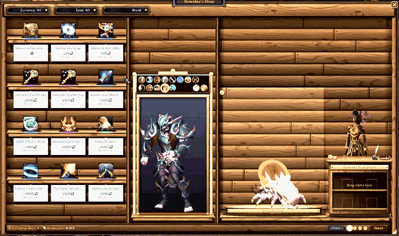

# VenStore



VenStore replaces the merchant window in World of Warcraft (Retail and WoW Forever) with a wooden shop interior. Items sit on shelves with hanging price cards. Cosmetics can be tried on in a standing mirror, and the vendor stands behind a sales counter.

## Features

- **Shelf grid:** Items stand on shelves, with price cards that show each currency. Drag the corner grip to resize the grid from 3×2 up to 7×5. The size you pick is saved.
- **Try-on mirror:** The tall cast-brass mirror only appears when the vendor sells transmog items (armor, weapons, ensembles and arsenals). Ctrl-Click one of these items to see it on your character. Your character fills the glass from head to feet at every angle; wings, weapons and spell effects that reach past the edge disappear behind the frame. The mirror stands on the shop floor, so your reflection stands at the same level as the vendor. The pose, undress and reset buttons are on the board above the glass.
- **Display plinth:** The plinth only appears when the vendor sells something with a 3D model: a mount, pet or housing decor. Toys have no model the game exposes. Ctrl-Click one of these items to show it to the left of the vendor. Items are measured and drawn in proportion to the vendor, standing on the plinth. The bay widens for long items, and nothing is cut off.
- **Fits the screen:** The window scales itself down if it would be larger than the screen.
- **Sales counter:** The live vendor model stands behind a tall wooden counter with a brass nameplate.
- **Shopping cart:** The front of the counter has two shelves. Drag up to four items onto them (or Alt-Click them on the shop shelves); the mouse wheel sets how many of each. Click the quill on the counter to sign the bill of sale: the quill floats up and signs, then everything is bought at once. Before signing, VenStore checks your gold, currencies and bag space; the quill's tooltip lists the totals.
- **Merchant services:** Buyback, Sell All Junk, Repair All (right-click to repair single items) and Guild Repair buttons sit on the header beam; repair buttons only appear at vendors who repair. Drop an item from your bags on the shop to sell it (right-clicking it in your bags works too).
- **Real wood grain:** The wood uses a generated texture (`textures/plank.tga`), tinted and lit per surface.
- **Filters:** Filter items by currency, item type and class/spec.
- **Wallet bar:** Shows how much of each currency this vendor accepts that you currently have.

## Controls

| Action | Result |
| --- | --- |
| Left-Click or drag item | Pick up (drop on your bags to buy now, or on the counter shelves to add it to the cart) |
| Alt-Click item | Add it to the cart |
| Right-Click item | Buy one |
| Ctrl-Click item | Preview in the mirror or on the plinth |
| Shift / modified click | Standard link / compare behavior |
| Drag a model | Rotate it |
| Mouse wheel on the mirror | Zoom out, and back in to the full-body view |
| Mouse wheel on the plinth | Zoom an item in, up to the edge of its frame (small items reach it in about six clicks) |
| Pose buttons above the mirror | Stand, Walk, Run, Combat Ready, Attack, Spell Ready, Wave, Bow, Cheer, Salute, Flex, Dance, Kneel |
| Undress / Reset buttons | Strip the mirror model / return to your current in-game appearance |
| Mouse wheel on a cart item | Change how many you're buying |
| Right-click a cart item | Take it off the counter |
| Click the quill (or the bill of sale) | Sign and buy everything in the cart |
| Right-click the mirror | Clear the try-on |
| Drop an item from your bags on the shop | Sell it |
| Buyback button | Show items you sold this session; click one to buy it back |
| Right-click the plinth model, or its × | Clear the display |
| Mouse wheel on the shop, or click a page stud | Change page |
| `/venstore reset` | Restore the default size and position |
| `/venstore vendor` | Switch the vendor between the 3D stage and the plain model view |
| `/venstore debug` | Print sizing information for bug reports |

## Project layout

| File | Purpose |
| --- | --- |
| `Data.lua` | Constants, merchant/currency helpers, cosmetic detection |
| `Wood.lua` | Procedural wood renderer (grain, knots, bevels, shadows, brass) |
| `Frame.lua` | Cabinet window, header beam, wallet bar, pager, resize grid |
| `Showroom.lua` | Mirror, display plinth, sales counter, vendor model, preview routing |
| `Cart.lua` | Cart shelves in the counter, bill of sale, inkwell and quill, checkout |
| `Services.lua` | Buyback, Sell All Junk, Repair and Guild Repair buttons |
| `Shelves.lua` | Shelves, item slots, price cards, main refresh |
| `Filters.lua` | Currency / type / spec dropdowns |
| `Events.lua` | Saved settings, merchant events, slash command |
| `textures/plank.tga` | Wood grain texture (1024×128, tiles horizontally) |
| `textures/quill.tga` | Quill (32×128 with alpha) |
| `tools/WoodGen.cs` | Generator for the wood texture (not shipped) |
| `tools/QuillGen.cs` | Generator for the quill texture (not shipped) |

To regenerate the wood texture, run this from PowerShell in the addon folder:

```powershell
Add-Type -Path tools\WoodGen.cs -ReferencedAssemblies System.Drawing
[WoodGen]::Plank("$PWD\textures\plank.tga", "$PWD\plank_preview.png", 7)
```

If you change the texture, update `PLANK_AVG` in `Wood.lua` with the average colour the generator prints. WoW only loads new texture files after a full client restart; `/reload` is not enough.

## Releasing

Releases are built by the [BigWigs packager](https://github.com/BigWigsMods/packager) (configured in `.pkgmeta`):

1. Add your notes to `CHANGELOG.md` and commit.
2. Create a tag such as `v1.0.0` and push it to GitHub. GitHub Desktop can do this from the History tab: right-click a commit, choose **Create Tag…**, then push.
3. The `Package and release` GitHub Action builds `VenStore-v1.0.0.zip` and attaches it to a GitHub release.

The packager replaces `@project-version@` in the TOC with the tag name.
